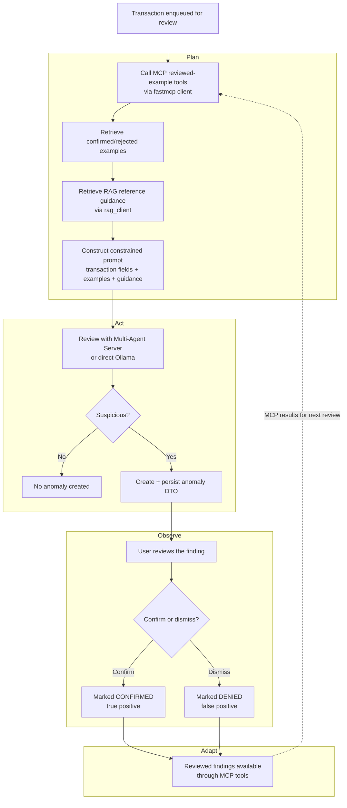

# Anomalies Backend

## Overview

The backend is a Flask application that provides the anomaly-detection API. It
coordinates transaction retrieval, asynchronous reviews, model requests, and
anomaly persistence. The application starts a daemon review worker when it is
initialised and returns JSON for API responses or rendered Jinja fragments for
the frontend.

Transactions are submitted for review as `dto.Transaction` objects. The backend
does not store transaction records itself; it retrieves transactions from the
transactions database and sends detected anomalies to the anomalies database.
Configuration such as service URLs, the model name, and polling timeouts is
read from environment variables in `config.py`. Values are resolved lazily, so
reading one raises a `RuntimeError` if the variable is unset or invalid;
`config.check_all()` validates every variable up front (it runs on startup).
The Compose deployment sets `MCP_SERVER_URL` to the host machine's MCP server
at `http://host.docker.internal:8000/mcp`; the MCP server is not containerised.
It also sets `RAG_SERVER_URL` to the shared, retrieve-only RAG server at
`http://host.docker.internal:5003` and `RAG_FEATURE` to `anomalies`; RAG can be
disabled with `RAG_ENABLED=false`. The RAG server is likewise not containerised.
When `MULTI_AGENT_ENABLED=true`, the worker submits the transaction, reviewed
examples, and RAG guidance to the shared Multi-Agent Server. The backend sends
`MULTI_AGENT_TOKEN` only as a server-side bearer token and uses the timeout set
by `MULTI_AGENT_TIMEOUT_SECONDS`; Compose sets it to 900 seconds, above the
shared server's 540-second workflow deadline. The direct Ollama review remains
available when this integration is disabled.

Compose increases the anomaly-service request timeouts through
`MCP_TIMEOUT_SECONDS` (60), `SERVICE_TIMEOUT_SECONDS` (120),
`OLLAMA_TIMEOUT_SECONDS` (600), and `RAG_TIMEOUT_SECONDS` (60). It also sets
`ANOMALY_WAIT_SECONDS` to 300 seconds for alert polling. The backend's existing
defaults remain unchanged when these environment variables are not set; the
nginx proxy timeout is 600 seconds.

## Agentic workflow

1. The frontend sends a transaction to `POST /check-transaction`.
2. The backend validates and deserialises the request into a transaction DTO.
3. The transaction is placed on the in-process review queue, and the endpoint
   immediately returns `HTTP 202 (Accepted)` with the transaction ID.
4. A background worker passes the transaction to the agent.
5. The agent calls the MCP server's
   `get_transactions_with_confirmed_anomalies` and
   `get_transactions_with_rejected_anomalies` tools through the `fastmcp` client
   to retrieve reviewed examples, and retrieves fraud/anomaly reference guidance
   for the transaction from the shared RAG server (`services/rag_client.py`).
   Both are embedded into the prompt before classifying the transaction.
6. With the shared server enabled, the backend submits that evidence as an
   `anomalies` workflow and validates the Worker's structured
   `is_suspicious`/`justification` result. Otherwise, it calls Ollama directly,
   which must return JSON containing those fields.
   Invalid direct Ollama responses are retried with increasing temperature, up
   to four attempts.
7. If the transaction is suspicious, the resulting anomaly is written to the
   anomalies database, including the filenames of the RAG documents used as
   `sources` and, for shared-server reviews, its `workflow_id`. Otherwise, no
   anomaly is created.
8. The worker marks the transaction as complete. The frontend can poll
   `GET /anomaly-alert?key=<transaction-id>` for a rendered alert fragment.

The agent is instructed to be cautious, avoid claiming fraud as fact, use only
the supplied transaction information, and incorporate the user's previous
confirmation or dismissal decisions.

For shared-server anomalies, the review dialog requires a reason. The backend
records `Accept` or `Reject` against the associated workflow before updating
the local anomaly status; a server failure leaves the local decision unchanged.
If workflow creation times out, the backend checks the latest Anomalies workflow
for the review request's unique evidence source instead of blindly creating a
second workflow.

## Plan–Act–Observe–Adapt workflow

The anomaly review implements a **Plan → Act → Observe → Adapt** loop whose
cycle spans *across* reviews: the user's decisions on one finding shape how the
agent judges the next transaction.

- **Plan** — Before classifying the transaction, `agent_api` calls the shared
  MCP server's `get_transactions_with_confirmed_anomalies` and
  `get_transactions_with_rejected_anomalies` tools through the `fastmcp` client
  (`services/mcp_client.py`), the same way the other services talk to the MCP
  server. These return reviewed transactions and their anomaly records as
  positive and negative examples, which are formatted and embedded into the
  user prompt. The agent also retrieves fraud/anomaly reference guidance for the
  transaction from the shared retrieve-only RAG server
  (`services/rag_client.py`), and embeds the closest excerpts as a "Reference
  guidance" section. The plan for judging the current transaction is therefore
  shaped by the accumulated human feedback and the reference material. If the
  MCP or RAG server is unavailable the review still proceeds without that input.
- **Act** — The agent sends the system and user prompts to the model through
  `ollama_api.prompt` when direct mode is enabled, or submits the evidence to
  the shared Multi-Agent Server when configured. Both paths must produce a
  finding with `is_suspicious` and `justification`. A valid, suspicious finding
  is converted to an anomaly DTO — with the model's mean confidence score
  derived from token log probabilities when available and the filenames of the
  RAG documents used as `sources` — and persisted so it can be shown to the
  user. Malformed responses from direct Ollama mode are retried with a higher
  temperature, up to four attempts.
- **Observe** — The persisted finding is surfaced to the user, who reviews it
  and records the ground truth by **confirming** it as genuinely suspicious
  (true positive) or **dismissing** it as a false positive. This human review
  is the observation of how well the agent's judgement matched reality.
- **Adapt** — Those confirmed/denied decisions are exactly the reviewed findings
  returned by the MCP tools on the *next* review. The agent treats transactions
  similar to confirmed findings as more likely suspicious, and avoids
  re-flagging transactions similar to denied ones. The loop then returns to Plan
  for the next transaction, with the agent's behaviour adapted to the user's
  accumulated feedback.

## Services

### `services/agent_api.py`

Implements the anomaly-detection agent. It fetches reviewed examples from the
MCP server through `services/mcp_client.py`, retrieves fraud/anomaly reference
guidance from the RAG server through `services/rag_client.py`, formats both into
the prompt, parses model JSON, validates the expected response fields, captures
the model's mean confidence (from token log probabilities), and converts
suspicious findings into anomaly DTOs (recording the RAG source filenames used).

### `services/rag_client.py`

Small HTTP client for the shared, retrieve-only RAG server. It exposes
`retrieve` and `health`, applies `RAG_TIMEOUT_SECONDS`, validates the response
shape, and maps every failure to a safe `RAGError` code so a RAG outage degrades
gracefully and never blocks anomaly detection. Retrieval is skipped when
`RAG_ENABLED` is false.

### `services/multi_agent_client.py`

Authenticated HTTP client for the shared Multi-Agent Server. It submits and
retrieves Anomalies workflows, records human decisions, applies the configured
timeout, and maps service failures to safe error codes.

### `services/mcp_client.py`

Thin `fastmcp` client for the shared MCP server, mirroring the other services'
clients. It exposes `list_tools` and `call_tool`, runs the async client from
synchronous code, applies `MCP_TIMEOUT_SECONDS`, and maps every failure to a
safe `MCPError` code so server details never leak.

### `ai-services/mcp-server/server.py`

Provides transaction search plus
`get_transactions_with_confirmed_anomalies` and
`get_transactions_with_rejected_anomalies`. The reviewed-example tools join
anomaly records from the anomalies database to their corresponding
transactions.

### `services/review_queue.py`

Provides the in-process queue and daemon worker. It tracks pending and
completed transaction IDs, runs reviews outside the request thread, persists
findings, and allows callers to wait for a specific transaction's result.

### `services/anomalies_api.py`

HTTP client for the anomalies database. It retrieves all anomalies, looks up an
anomaly by transaction ID, creates anomalies, and updates user confirmation
status.

### `services/transaction_api.py`

HTTP client for the transactions database. It retrieves transaction records
used for anomaly listings and agent context.

### `services/ollama_api.py`

OpenAI-compatible client wrapper for the model server. It caches one client
instance and sends system and user prompts through Ollama's Chat Completions API
with the configured model, temperature, token limit, and timeout. It requests
token log probabilities and returns a `PromptResult` with the response `text`
and the `mean_confidence` (the arithmetic mean of each chosen token's
probability, `exp(logprob)`), or `None` when the server does not return log
probabilities. Set `OLLAMA_LOG_LEVEL=DEBUG` to log the response's
log-probability field locations, their shape, and the number of token scores
extracted when investigating missing confidence values, for example with
`docker compose logs -f anomalies-backend`.

### `helpers.py`

Contains request DTO deserialisation, DTO serialisation, and environment
variable helpers used by the application and integration clients.

## Routes

| Method | Route | Purpose |
| --- | --- | --- |
| `GET` | `/` | Returns the backend health response. |
| `GET` | `/fact` | Requests and returns a random fact from the configured model. |
| `GET` | `/anomalies` | Retrieves anomalies and transactions, then renders the anomaly list. |
| `POST` | `/check-transaction` | Validates and queues a transaction for asynchronous review; returns `202`. |
| `GET` | `/anomaly-alert?key=<id>` | Waits for a queued review and returns an alert fragment when an anomaly exists, otherwise `204`. |
| `POST` | `/anomalies/<id>/confirm` | Marks an anomaly as confirmed and returns the refreshed anomaly list. |
| `POST` | `/anomalies/<id>/dismiss` | Marks an anomaly as dismissed and returns the refreshed anomaly list. |
| `POST` | `/dummy-anomaly` | Creates a random test anomaly and returns the refreshed anomaly list. |

Shared-server anomaly decisions include a `reason` in the JSON request body;
legacy anomalies without a workflow ID retain their existing decision behavior.
