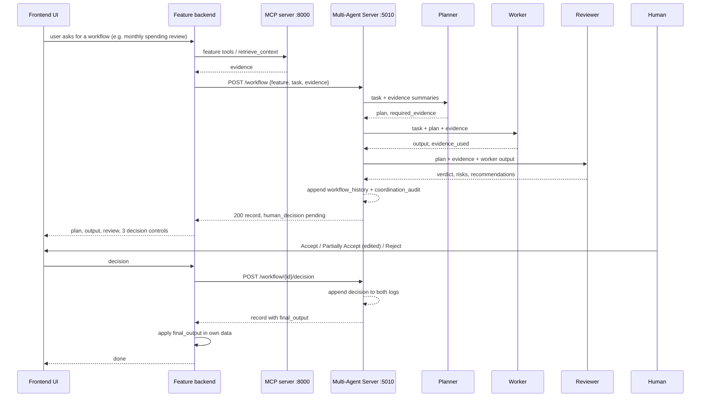

# ADR: One shared Multi-Agent Server with a feature-neutral workflow contract

Status: proposed, 17 Oct 2026. Author: Sophia Nguyen (Bills). Implementer:
Ethan (server). Consumers: all five feature backends, the shared agentic loop,
the terminal runner.

## Context

Assessment 3 requires one shared, non-containerised, local Multi-Agent Server
that coordinates Planner, Worker and Reviewer agents, includes human review
(approval, correction, partial acceptance or rejection) inside the workflow,
is callable from the integrated application and from the terminal, is
disabled by default in the cloud, and produces workflow history and
coordination/audit evidence for the report. Criterion 2 (3 marks) is marked
on that workflow running through the frontend UI and the terminal with that
evidence; criteria 1, 8, 9 and 10 cite it as well.

Nothing exists on `main` yet (17 Oct). Ethan took the server on 15 Oct, David
asked for it by the weekend so the five features can integrate before the
23 Oct showcase, and Janelle is adding the Multi-Agent Review mode to the shared
loop at the same time. Without an agreed interface the three pieces cannot be
built in parallel.

Lab 10 (`asd-labs/Lab_10_Multi_Agent_Coordination.md`) gives the marker's
reference shape: `multi-agent-server/` with `POST /workflow` and
`GET /workflow/status`, agents on `qwen2.5:0.5b` (Planner, Worker) and
`llama3.1:8b` (Reviewer), `workflow_history.jsonl` and
`coordination_audit.jsonl`, and a human decision of Accept, Partially Accept
or Reject that the lab records only on paper. The lab's port (5004) is
Anomalies in Tally.

The Release 2 demonstration features Transactions: the monthly spending
review. Bills (the dispute letter and Ask Tally) is the second documented
case because its outputs are prose and exercise the correction path. The
rubric still requires every feature to integrate and demonstrate the
workflow (see Consequences).

## Decision

Build `ai-services/multi-agent-server/` beside `mcp-server/` and
`rag-server/`, run as `python ai-services/multi-agent-server/server.py` on the
host, never in `docker-compose.yml`, and expose the contract below. The
server owns the agents, the logs and the human-decision record; each feature
owns a client that speaks the contract and applies the result in its own
data. The server never reads or writes a feature database.

### Runtime

| Item | Value |
| --- | --- |
| Bind | `0.0.0.0:5010` (`MULTI_AGENT_PORT`); containers reach it at `http://host.docker.internal:5010` through the existing `extra_hosts: host-gateway` |
| Models | Planner and Worker `qwen2.5:0.5b`, Reviewer `llama3.1:8b`, via `OLLAMA_BASE_URL` (default `http://127.0.0.1:11434`), the pair the shared loop already pulls |
| Prompts | `prompts/multi_agent/{planner,worker,reviewer}_prompt.txt`, the folder convention the loop uses, so the Multi-Agent Review mode can read them |
| Timeouts | `AGENT_STEP_TIMEOUT_SECONDS` (default 60); a step that times out is recorded with `"status": "timeout"` and the workflow continues to human review, as in Lab 10 |
| Logs | `ai-services/multi-agent-server/logs/workflow_history.jsonl` and `coordination_audit.jsonl`, gitignored; one sample run per feature committed under `docs/release-2/<name>/multi-agent/` |
| Cloud | Not deployed in the required build. Bicep gains `enableMultiAgent` (default `false`) beside `enableMcp` and `enableRag`, so every backend gets `MULTI_AGENT_ENABLED=false`. Bonus B4 enables it on the Ollama VM |

### HTTP contract

All bodies are JSON. Errors are `{"status": "error", "error": "<message>"}`
with 400 (bad request), 404 (unknown workflow), 409 (decision already
recorded) or 503 (no model output could be produced).

| Route | Purpose |
| --- | --- |
| `POST /workflow` | Run Planner → Worker → Reviewer and stop at human review. Blocks until the Reviewer finishes (5–30 s locally; clients allow 90 s) |
| `POST /workflow/<id>/decision` | Record the human decision. Second decision for the same id → 409 |
| `GET /workflow/<id>` | One record, with `human_decision` as it stands |
| `GET /workflow/status` | Counts of history, audit, pending decisions, per-feature totals and the latest record; `?feature=` filters |
| `GET /health` | `{"service", "ok", "ollama", "models", "mcp"}`, same shape as the backends' `/health` so the loop and `deploy.sh health` probe it alike |

`POST /workflow` request:

| Field | Required | Meaning |
| --- | --- | --- |
| `feature` | yes | `transactions`, `savings`, `anomalies`, `bills` or `budgets`; selects the feature prompt fragment and scopes the logs |
| `task` | yes | One plain sentence (Lab 10's `user_request`), shown verbatim in the UI and the logs |
| `evidence` | yes, may be empty | `[{"source", "summary", "data"}]`. The backend gathers these through its own MCP/RAG clients; `source` names the tool or collection, `summary` is the sentence the agents read, `data` is echoed back |
| `context` | no | Free-form, passed to the prompts (demo date, user) |
| `options.plan_only` | no | Return after the Planner; `worker_result` and `reviewer_result` are `null`, `human_decision.status` is `awaiting_evidence` |
| `options.reuse_plan` | no | A `workflow_id` from a `plan_only` call; the server skips the Planner and runs Worker and Reviewer under that id |

`POST /workflow` response (200), abridged to the fields every consumer reads
(Bills example; a Transactions response carries `structured` instead of a
prose `output`):

```json
{
  "status": "success", "workflow_id": "7f3c…", "feature": "bills", "task": "…",
  "timestamp": "2026-10-19T09:14:02Z", "duration_ms": 8420,
  "participating_agents": ["planner_agent", "worker_agent", "reviewer_agent"],
  "planner_result":  {"status": "success", "agent": "planner_agent",  "model": "qwen2.5:0.5b", "plan": ["…"], "required_evidence": ["…"], "human_approval_required": true},
  "worker_result":   {"status": "success", "agent": "worker_agent",   "model": "qwen2.5:0.5b", "evidence_count": 2, "evidence_used": ["mcp:compare_bill_with_bank_charges", "rag:billing"], "output": "Dear Optus, …", "structured": null, "human_approval_required": true},
  "reviewer_result": {"status": "success", "agent": "reviewer_agent", "model": "llama3.1:8b", "verdict": "approve_with_changes", "risks": ["…"], "recommendations": ["…"], "review": "…", "human_approval_required": true},
  "human_decision":  {"required": true, "status": "pending", "allowed_values": ["Accept", "Partially Accept", "Reject"]}
}
```

Each agent `status` is `success`, `timeout` or `error` (with `"error"`);
`verdict` is `approve`, `approve_with_changes` or `reject`. `structured` is
an optional object the feature defines for list-shaped outputs (Transactions,
the featured case: `totals`, `proposed_categories`, `flagged`, every item
citing a transaction id from the evidence). The Reviewer is instructed to reject any id or category
name absent from `evidence`.

`POST /workflow/<id>/decision` request:

| Field | Required | Meaning |
| --- | --- | --- |
| `decision` | yes | `Accept`, `Partially Accept` or `Reject`. `Partially Accept` is the brief's "correction" |
| `corrected_output` | with `Partially Accept` | A string for prose outputs (the edited letter), or an object shaped like `structured` for list outputs (the edited lists). Absent for `Reject` |
| `reason`, `decided_by` | no | Logged |

Response: the full record with `human_decision` set to
`{"status": "recorded", "decision", "final_output", "reason", "decided_by", "timestamp"}`.
`final_output` is the Worker output (`structured` when present) on Accept,
`corrected_output` on Partially Accept, `null` on Reject.

### Logs

`workflow_history.jsonl` holds the full record at run time and again, same
`workflow_id`, when the decision lands; readers take the last line per id.
`coordination_audit.jsonl` holds one line per event with `ts`, `workflow_id`,
`feature`, `event` and the event's fields: `workflow_started` (task),
`agent_finished` (agent, status, duration_ms, and evidence_count or verdict),
`handoff` (from, to, human_approval_required), `human_decision` (decision,
decided_by), `error`. These are the lines the loop's Multi-Agent Review mode
reads and the report quotes.

### Terminal

`workflow_runner.py --feature bills --task "…" --evidence evidence.json` and
`workflow_runner.py --decide <id> --decision Accept` call the same functions
the routes call and print the record; this is the brief's "callable from the
terminal" and the fastest way to capture report samples.

### Feature-side obligations

1. A client with `MULTI_AGENT_ENABLED` (false in code, `${…:-true}` in
   compose, false in CI and cloud), `MULTI_AGENT_SERVER_URL` (default
   `http://host.docker.internal:5010`) and `MULTI_AGENT_TIMEOUT_SECONDS`
   (default 90), the `MCP_ENABLED` / `MCP_SERVER_URL` pattern.
2. One route that gathers evidence and calls `POST /workflow`, one that
   forwards the decision and applies `final_output`; both return 503
   `{"code": "multi_agent_disabled"}` when off, like the MCP and RAG routes.
3. A UI surface showing plan, output, Reviewer risks and the three decision
   controls, with an editable field for Partially Accept.
4. `/health` reports `"multi_agent": "disabled" | "up" | "down"`.
5. One recorded end-to-end run (history + audit lines + screenshot) under
   `docs/release-2/<name>/multi-agent/`.

### Use cases the contract is tested against

- **Transactions monthly spending review (featured).** Evidence from
  `search_transactions` and `retrieve_context(feature="transactions")`.
  Planner: total by category, propose a category for each uncategorised
  row, list rows to flag. Worker returns `structured` lists
  (`totals`, `proposed_categories`, `flagged`), every item citing a
  transaction id from the evidence. Reviewer: every proposed category
  exists, totals add up, no id is invented. On Accept or an edited
  Partially Accept the backend applies `PUT /transactions/<id>` per proposal
  and notes flagged rows; nothing is written before the decision. Featured
  because the human decision visibly changes data the marker can see in the
  UI.
- **Bills dispute letter (documented).** Evidence from
  `compare_bill_with_bank_charges` and `retrieve_context(feature="billing")`.
  Planner lists what a dispute needs; Worker drafts citing bank facts only
  (the Release 1 rule); Reviewer flags unsupported claims; the human accepts,
  edits (Partially Accept) or rejects in the existing dispute panel, and the
  backend saves `final_output` as the letter draft.
- **Bills Ask Tally (documented).** The chat question is the task. First call
  with `plan_only`: the Planner names the tools to fetch; the backend fetches
  them and calls again with `reuse_plan`; the Worker answers with citations,
  the Reviewer checks every date and amount against the evidence; the human
  accepts, edits or rejects, and the backend stores `final_output` as the
  chat turn with the `workflow_id`.

## Alternatives considered

- **Each feature runs its own Planner/Worker/Reviewer inside its backend.**
  Rejected: the brief says one shared server five times and marks it as a
  shared service, as it did the MCP and RAG servers in Release 1; the Release
  1 lesson (Grace, 18 Sep) was that shared helper code alone does not
  demonstrate a server architecture.
- **Lab 10 as-is: `POST /workflow` with `user_request` only, no decision
  endpoint, server reads the database.** Rejected: the brief requires the
  human decision to be part of the workflow and its evidence; five features
  have five databases behind MCP tools, so the server would need every
  feature's credentials; and without `feature` the logs cannot be filtered
  per student for the report.
- **Server calls MCP and RAG itself, backends send only the task.**
  Rejected for the first PR: every backend already has MCP/RAG clients and
  Release 1 guard rules (Bills' "bank facts only"); moving retrieval into the
  server duplicates that and makes the server depend on both other servers
  being up. Kept as an optional `options.use_mcp` for later.
- **Lab 10's port 5004 and `/multi-agent/*` backend prefix.** Port rejected
  because 5004 is Anomalies; 5010 is free (5001–5006 backends, 5003 RAG,
  8000 MCP). The backend prefix is each feature's choice.
- **Synchronous single call including the human step.** Rejected: the human
  may take minutes; the decision is a second request so the server stays
  stateless between the two apart from the stored record.

## Consequences

- Ethan can build the server and the five features can build clients and UI
  against a stub of this contract at the same time; Janelle's Multi-Agent Review
  mode reads the audit lines named above.
- `deploy.sh health`, `bicep/main.bicep` (`enableMultiAgent`) and
  `docker-compose.yml` (`MULTI_AGENT_ENABLED`, `MULTI_AGENT_SERVER_URL` on
  every backend) change; David owns those files.
- `plan_only` / `reuse_plan` add one early return and one stored-plan lookup
  to the server; they exist for Ask Tally and cost nothing when unused.
- Partially Accept carries the user's edited text or lists, so the report
  can show the correction path on data the marker can read.
- A featured workflow is a showcase choice, not a rubric one. The brief's
  individual responsibilities say each student must "integrate the assigned
  feature with the shared Multi-Agent Server and demonstrate the Planner,
  Worker, Reviewer, and human-review workflow", criterion 10 requires each
  student to defend their own Release 2 contribution, and criterion 2 is
  marked on the workflow through the frontend UI without naming a feature.
  So Transactions opens the demo and the group report section, and every
  other feature, Bills included, still shows its own run and commits its
  own evidence under `docs/release-2/<name>/multi-agent/`.
- Open for the team: whether Planner and Worker run in parallel (Lab 10) or
  the Worker receives the plan (this ADR's prompts assume it does); whether
  `options.use_mcp` ships at all; and the port and Bicep parameter, which need
  David's sign-off.

## Sequence


