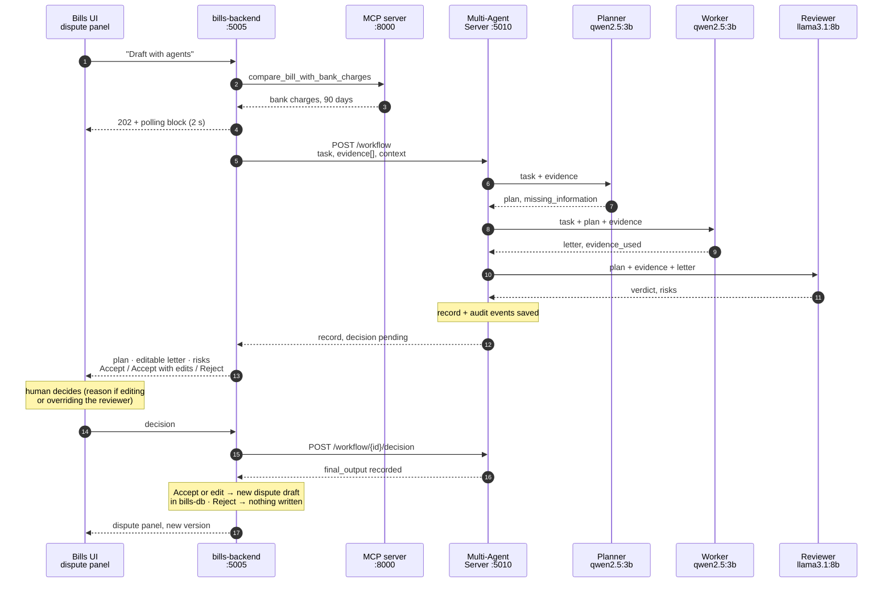
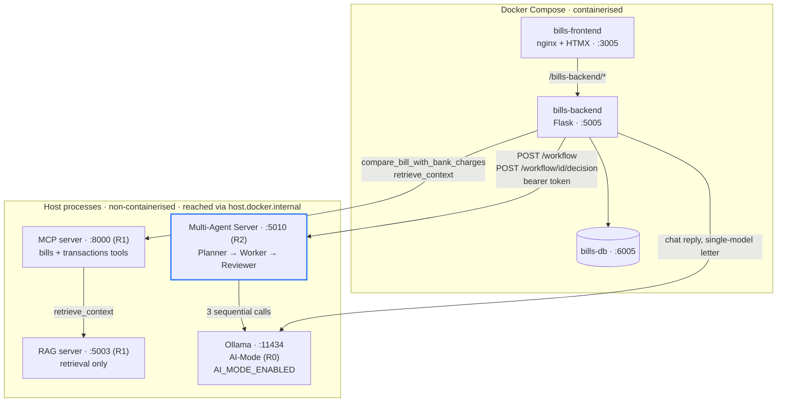
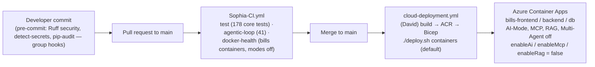

# Bills — Release 2 design flow

Owner: Sophia Nguyen (Bills List & Dispute Assistant). Branch `sophia/r2-bills-multi-agent`, PR #220.

The Release 1 flows are unchanged: the Bills backend reaches the shared MCP server for bank facts and the shared RAG server (through the MCP tool `retrieve_context`) for policy facts, and Ollama for the single-model Ask Tally reply and dispute letter. Release 2 adds the shared Multi-Agent Server as a fourth non-containerised local service. The backend gathers evidence through the Release 1 clients, sends one task to the server, the three agents run in sequence, and the human decides in the Bills UI before anything is written.

## 1. Release 2 flow: dispute letter through the Multi-Agent Server

The Ask Tally suggestion workflow is the same sequence with a different task: the backend sends the user's words and the bill rows as evidence, the Worker returns the change as a JSON object (`{op, entity, id, fields}`), and Accept applies it through the Release 1 suggestions flow after the same vetting every chat proposal gets. Plain questions never reach the server.

## 2. Bills architecture with the Release 2 service

Switches: `AI_MODE_ENABLED`, `MCP_ENABLED`, `RAG_ENABLED`, `MULTI_AGENT_ENABLED` on bills-backend (code default off; CI and the cloud baseline `false`; compose defaults them on for the local AI topology). With a switch off the matching route answers 503 with a safe code (`ai_disabled`, `multi_agent_disabled`) and the rest of Bills works unchanged. `AI_MODE_ENABLED` gates `guard.run` before its first attempt, so a disabled deployment refuses rather than serving the templated fallback as though the model had replied, and `/health` reports `modes.ai: "disabled"` without probing Ollama.

## 3. Deployment flow (Bills slice of the group pipeline)

`./deploy.sh` defaults to `containers`, the required baseline: no Ollama VM, and all four switches off. `./deploy.sh all` provisions the Ollama VM for the optional AI topology (Bonus Marks), and AI mode still needs `enableAi=true` passed explicitly — the VM existing does not turn AI on. `cloud-deployment.yml` passes `containers` or `update` explicitly, so the pipeline does not deploy the VM; the old `all` default only applied to a hand-run `./deploy.sh`.

The two post-commit endpoint tests Sophia-CI runs on every push (criterion 4) are `test_multi_agent_routes.py::test_letter_workflow_sends_bills_evidence_and_waits_for_the_human` (`POST /api/disputes/<id>/workflow`) and `::test_accept_stores_the_letter_as_the_next_draft_with_the_review` (`POST /api/disputes/<id>/workflow/<workflow_id>/decision`), both driving the real server coordinator with a fake model on the live seeded database; the `docker-health` job then calls the built container's `/health`, `/api/evidence` and `/api/tools/retrieve_context` and asserts the modes-off refusals.
